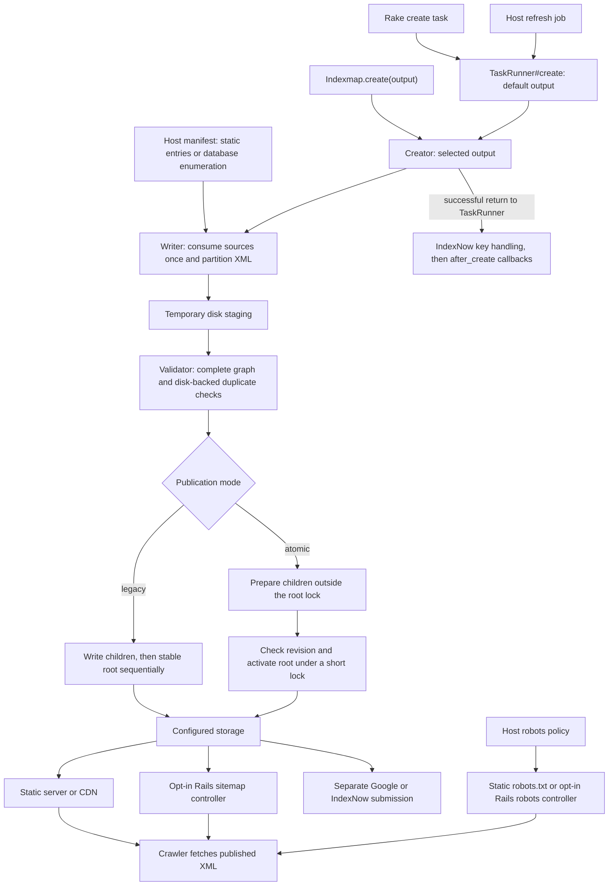

# How Indexmap works

The host supplies eligible URLs and content dates. Indexmap generates, validates,
and publishes XML. A web server, CDN, or explicitly mounted Rails controller
serves those artifacts. Crawlers do not trigger generation or query section sources.

Generation and validation errors occur before publication. Legacy writes can
leave mixed files if publication itself fails. Atomic mode retains the previous
root until activation succeeds; a competing winner causes
`Indexmap::SupersededPublication`. Built-in adapters clean up ordinary failed
builds; retention covers artifacts left by crashes. Cleanup errors are reported
explicitly. Callbacks and key handling run after publication,
so their failures do not undo it. Neither generation entrypoint submits to search
engines automatically. A host can choose to submit from a callback, but separate
submission makes refresh retries easier to operate.

| Entrypoint | Purpose |
| --- | --- |
| `Indexmap.create(:name)` | Generate, validate, and publish one output; defaults to `:default`. |
| `Indexmap::TaskRunner.new.create` | Generate the default output, handle the IndexNow key, then invoke callbacks. |
| `indexmap:sitemap:create` | Run `TaskRunner#create` and print the writer's recorded counts. |
| `Writer#each_file` / `Writer#write` | Render XML files; callers own validation and publication. `write` collects all files. |
| `indexmap:sitemap:format` | Optionally pretty-print legacy stored files; atomic outputs reject mutation. |
| Sitemap / robots controllers | Serve artifacts or configuration; never generate a sitemap. |

See [domain terms](domain-terms.md), [deployment choices](deployment.md), and the
[storage contract](storage.md).
